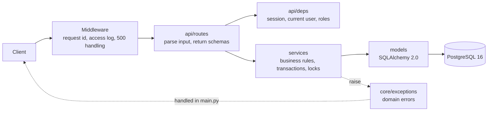
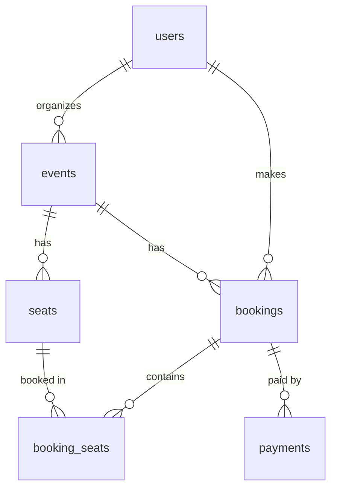

# Event Booking API

[](https://github.com/rajatmungra/event-booking-api/actions/workflows/ci.yml)

A REST API where organizers publish events with seat layouts and customers hold, pay for and
cancel seats. **A seat can never be double-booked, even when many people click "book" at the same
moment.** An automated test proves it: 50 parallel requests for one seat, exactly one wins.

**Live demo:** https://event-booking-api-ld4j.onrender.com/docs (interactive API docs)

Built with FastAPI (async), PostgreSQL 16, SQLAlchemy 2.0 + asyncpg, Alembic, Pydantic v2, JWT
auth with argon2 password hashing, uv, Ruff, pytest and Docker.

---

## Features

- **Roles:** customers book seats, organizers manage their own events, admins can do everything.
- **Events:** draft → published → cancelled, with ownership checks, search, date filters and
  pagination.
- **Seat layouts:** a whole layout (e.g. 3 sections × 10 rows × 20 seats) is created in one request.
- **Bookings:** seats are held for 10 minutes; expired holds become free again automatically.
- **Payments:** a mock payment endpoint that is idempotent (`Idempotency-Key` header), so retries
  never charge twice.
- **Cancellation:** customers can cancel until 24 h before the event (payment refunded); cancelling
  an event cancels and refunds all its bookings.
- **Organizer stats:** seats sold, seats held, revenue and occupancy, computed in SQL.
- **Production basics:** one JSON error format, request ids, structured JSON logs, a login rate
  limit, migrations, CI and a seed script.

---

## How double-booking is prevented

`POST /bookings` does everything in **one database transaction**:

```python
seats = await session.scalars(
    select(Seat)
    .where(Seat.event_id == event.id, Seat.id.in_(sorted(seat_ids)))
    .order_by(Seat.id)  # every request locks rows in the same order → no deadlocks
    .with_for_update()  # SELECT ... FOR UPDATE: lock these seat rows until commit
)
# check every seat is free (available, or held with an expired hold) → else 409 SEAT_UNAVAILABLE
# mark them held for 10 minutes, create the pending booking, commit (releases the locks)
```

- `SELECT ... FOR UPDATE` locks the requested seat rows. Any other transaction that wants one of
  those seats waits until we commit, then sees the seat as `held` and gets **409 Conflict**.
- The check and the update happen while holding the lock, so there's no gap where two requests
  can both see "available".
- Rows are always locked in id order. If two requests locked {A, B} and {B, A} in opposite orders,
  each could wait for the other forever (a deadlock).
- **Expiry is lazy:** a held seat whose `held_until` has passed counts as free on the next booking
  attempt, so correctness never depends on a background job.

All write paths take locks in the same order, **event → booking → seat**:

| Operation | Locks (in order) |
|---|---|
| Create booking | event `FOR SHARE` → seats `FOR UPDATE` |
| Pay | booking → seats |
| Cancel booking | booking → seats |
| Cancel event | event `FOR UPDATE` → bookings → payments → seats |

The `FOR SHARE` lock on the event lets many bookings run in parallel. An organizer cancelling the
event (`FOR UPDATE`) waits for bookings already in progress, and later bookings wait for the cancel.

**The proof** (`tests/test_concurrency.py`): 50 different customers send `POST /bookings` for the
same seat at the same time (`asyncio.gather`, one database connection each):

```python
statuses = [response.status_code for response in responses]
assert statuses.count(201) == 1
assert statuses.count(409) == 49
```

With `.with_for_update()` removed, all 50 requests "win" the seat and the test fails. CI runs the
concurrency tests 10 times on every push. The same file also checks:
- requests for overlapping seats in random order never deadlock
- 10 parallel payment retries with one `Idempotency-Key` create exactly one payment
- cancelling an event while bookings are in progress leaves no active booking

---

## Architecture



- **Routes are thin.** They parse input, call a service and return a Pydantic schema. They never
  return ORM objects.
- **All business rules live in `services/`.** Services raise domain exceptions (for example
  `SeatUnavailable`), and one handler in `main.py` turns them into the shared error format.
- Everything is async: one `AsyncSession` per request, provided by the `get_session` dependency.

### Data model



- **Money** is stored as integer cents. **Timestamps** are timezone-aware UTC. **Primary keys** are UUIDs.
- **Uniqueness the database enforces:** a seat `(event_id, section, row, number)`, a user's
  `email`, and a payment's `idempotency_key`.

### Error format

Every error, including validation errors and unknown routes, has the same shape:

```json
{"error": {"code": "SEAT_UNAVAILABLE", "message": "One or more seats are already held or booked.",
           "details": {"seat_ids": ["4f1c..."]}}}
```

Every response includes an `X-Request-ID` header, and the same id appears in every log line for
that request.

---

## API

Interactive docs are at `/docs`. To log in there, click **Authorize** and use the email as the username.

| Method | Path | Who | What |
|---|---|---|---|
| POST | `/auth/register` | anyone | Create a customer or organizer account |
| POST | `/auth/login` | anyone | OAuth2 password form → access token (60 min); 5 attempts/min |
| GET | `/users/me` | logged in | Current user |
| GET | `/events` | anyone | Published events; `q`, `starts_after`, `starts_before`, `limit`, `offset` |
| GET | `/events/{id}` | anyone | One event (drafts only for their owner) |
| POST | `/events` | organizer | Create a draft event |
| PATCH | `/events/{id}` | owner | Update fields |
| POST | `/events/{id}/publish` | owner | Draft → published |
| POST | `/events/{id}/cancel` | owner | Cancel event, cancel and refund all its bookings |
| POST | `/events/{id}/seats` | owner | Create the seat layout from sections |
| GET | `/events/{id}/seats` | anyone | Seat map with availability |
| GET | `/events/{id}/bookings` | owner | All bookings for the event |
| GET | `/events/{id}/stats` | owner | Seats sold/held/available, revenue, occupancy % |
| POST | `/bookings` | customer | Hold seats for 10 minutes |
| GET | `/bookings` | logged in | My bookings |
| GET | `/bookings/{id}` | owner | One booking |
| POST | `/bookings/{id}/pay` | owner | Mock payment; requires `Idempotency-Key` header |
| POST | `/bookings/{id}/cancel` | owner | Cancel until 24 h before the event; refunds payment |
| GET | `/health` | anyone | Checks the database connection |

Admins pass every role and ownership check.

---

## Run locally

Requirements: Docker and [uv](https://docs.astral.sh/uv/).

```bash
cp .env.example .env              # then set POSTGRES_PASSWORD, JWT_SECRET (openssl rand -hex 32), SEED_PASSWORD
docker compose up --build -d      # api on :8000, Postgres on :5434
docker compose exec api uv run alembic upgrade head
docker compose exec api uv run python -m scripts.seed   # optional demo data
```

Open http://localhost:8000/docs. The seed creates `organizer@example.com`, `customer@example.com`
and `admin@example.com`, all with your `SEED_PASSWORD`.

### Tests and lint

The tests run against a real Postgres, because SQLite has no `SELECT ... FOR UPDATE`.

```bash
docker compose up -d db-test      # throwaway in-memory Postgres on :5435
uv sync
uv run pytest
uv run ruff check . && uv run ruff format --check .
```

### Migrations

```bash
docker compose exec api uv run alembic revision --autogenerate -m "describe the change"
docker compose exec api uv run alembic upgrade head
docker compose exec api uv run alembic check      # models and migrations in sync?
```

---

## Deploy to Render

`render.yaml` is a [Render Blueprint](https://render.com/docs/blueprint-spec). It creates the web
service (built from the `Dockerfile`) and a managed Postgres 16 database.

1. Push this repository to GitHub.
2. In Render, choose **New → Blueprint** and select the repository.
3. When asked, enter `SEED_PASSWORD` (at least 8 characters). Render generates `JWT_SECRET` itself
   and connects `DATABASE_URL` to the new database.
4. Deploy. `scripts/start.sh` runs `alembic upgrade head`, then starts uvicorn on Render's `$PORT`
   with `--proxy-headers`, so the rate limiter sees real client IPs.
5. Optional, demo data: run `uv run python -m scripts.seed` in the service's **Shell** tab. If your
   plan has no shell, run it from your machine against the database's external URL:
   `DATABASE_URL="<external database URL>" SEED_PASSWORD="..." uv run python -m scripts.seed`.

On the free plan, the service sleeps when idle (the first request then takes a while), and the
free database is time-limited. Check Render's current plan limits.

---

## Project structure

```
app/
├── main.py            app, routers, middleware, error handlers, /health
├── core/              config, security (JWT, argon2), exceptions, logging, rate limit
├── db/                declarative base (constraint naming), async engine + session
├── models/            SQLAlchemy models: user, event, seat, booking, payment
├── schemas/           Pydantic request/response models
├── services/          business logic: auth, events, seats, bookings, payments
└── api/               deps (auth, roles) and routes
alembic/               migrations
scripts/               seed.py (demo data), start.sh (production start)
tests/                 pytest + httpx against a real Postgres, incl. test_concurrency.py
```

---

## Design decisions and trade-offs

- **Locking before writing (`FOR UPDATE`) instead of detecting conflicts afterwards.** It's simple,
  and it's the right choice for a few very popular seats that many people want at once. The
  alternative, optimistic locking with a version column and retries, suits workloads where
  conflicts are rare.
- **Lazy expiry instead of a background worker.** Holds expire correctly even if no job runs.
- **The idempotency key is stored on the payment row,** with a unique constraint. Retries wait on
  the booking lock and then get the original payment back. The constraint guarantees one payment
  per key even if the lock were missing.
- **Access tokens only (60 min), no refresh tokens.** Kept out to stay focused on booking
  correctness.
- **The rate limiter is in memory.** Good enough for a single instance. Several instances would
  need a shared store such as Redis.
